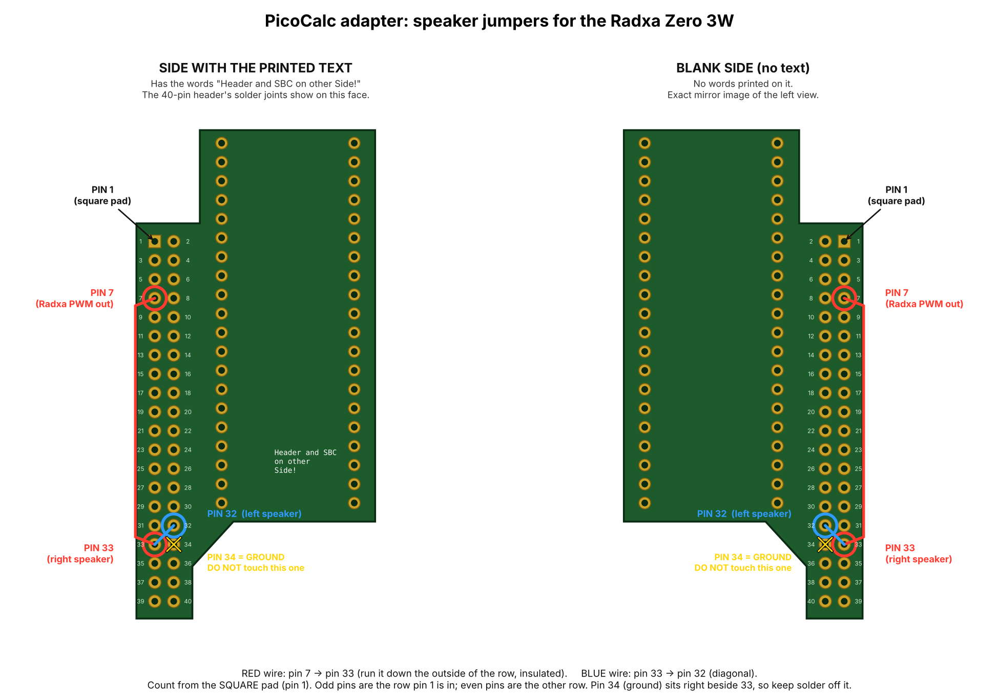

# Addendum: Speaker and headphone audio (Radxa Zero 3W, Armbian)

This addendum covers getting sound out of the PicoCalc's own speaker and headphone jack with a Radxa Zero 3W on the Michael Mayer ZeroCalc adapter. It takes two short jumper wires and some software. The end result is clean sound on the speaker and the headphone jack, with the volume wheel still working.

Items are labeled **Verified** (seen working on the real hardware), **Observed** (seen, cause is our best guess) or **Untested**.

## Test system

- Radxa Zero 3W, 2 GB RAM, in a ClockworkPi PicoCalc
- Michael Mayer / `ironat` ZeroCalc adapter
- Armbian, kernel `6.1.115-vendor-rk35xx`, PipeWire + WirePlumber
- Display and keyboard set up as in the main guide

## Why there's no sound out of the box

- **Verified:** with no changes, the only sound card Linux sees is `rockchip-hdmi0`. Games and movies play into the micro-HDMI port.
- **Verified:** the adapter is laid out like a Pi Zero adapter. Its Gerber files route the PicoCalc's audio lines to header **pin 32 (PWM_L)** and **pin 33 (PWM_R)**. On a Raspberry Pi those are PWM audio pins, so a Pi Zero 2W gets sound with one config line.
- **Verified:** on the Radxa Zero 3W, pins 32 and 33 cannot do hardware PWM. The nearest usable PWM (PWM14_M0) comes out on **pin 7**, which the adapter leaves unconnected.
- From the PicoCalc schematic: only the **left** line (pin 32) reaches the speaker amp. The right line only goes to the headphone jack.

## The jumper wires

Solder these on the back of the adapter, where the Radxa's header pins come through. Find the **square pad**: that's pin 1. Count from there.



*Drawn from the adapter's Gerber files, so the pad positions are exact. Use whichever view matches the side facing you.*

| Wire | From | To | Notes |
|---|---|---|---|
| 1 | Pin 7 | Pin 33 | Insulated wire, run down the outside of the odd-numbered row so it doesn't touch the pins in between |
| 2 | Pin 33 | Pin 32 | Short diagonal piece of wire. Pin 32 is one row up, not right beside 33 |

> **Watch pin 34.** Pin 34 is **ground** and sits right beside pin 33. A solder bridge from 33 to 34 shorts the audio to ground. After soldering, a continuity check from 33 to 34 should **not** beep.

A dab of hot glue over the joints works well for strain relief.

**With the final software setup (below), pin 7 is no longer used.** Sound goes out pin 32, and the 32–33 bridge feeds the right side of the headphone jack. The pin 7 wire is harmless, so it can stay.

## Software: what didn't work well, and what did

### First attempt: PWM driver on pin 7 (not recommended)

A custom kernel driver fed the PWM on pin 7 one sample at a time from a timer. It worked, but it topped out at roughly 8-bit sound with audible hiss, even after several revisions.

Things learned along the way:

- **Verified:** `armbian-config`'s overlay menu fails on this image with "invalid overlay prefix". `armbianEnv.txt` says `overlay_prefix=rk35xx`, but the overlay files are named `rk3568-*.dtbo`. Load overlays by copying them into `/boot/overlay-user/` and adding them to `user_overlays=` instead. Don't change `overlay_prefix`, because the boot script also uses it to find a fixup script.
- **Verified:** the Rockchip PWM driver only switches the PWM register clock on while it changes settings. A driver that writes the duty register every sample has to keep that clock on itself.

### Final setup: 1-bit audio over I2S on pin 32 (Verified, recommended)

Pin 32 can also be the Radxa's **I2S1 SDO3** data line. The I2S hardware streams bits on its own steady clock, so instead of a timer poking the PWM, a small converter turns normal audio into a fast 1-bit stream (delta-sigma modulation). The PicoCalc's existing filter smooths that back into sound, the same way it does for the Pico's PWM.

Pieces:

1. **Device-tree overlay** `picocalc-i2s-dsm.dtbo` in `/boot/overlay-user/`. Turns on I2S1 and puts only its SDO3 line on pin 32. The PWM overlays are removed from `user_overlays` so nothing else drives that wire.
2. **Stand-in codec driver** `picocalc_dsm_codec.ko` in `/lib/modules/$(uname -r)/extra/`. The I2S driver expects a codec on the other end of the link, and the PicoCalc has none, so this one just accepts the bits.
3. **The 1-bit converter**, an ALSA plugin: `libasound_module_pcm_picocalc_dsm.so` in `/usr/lib/aarch64-linux-gnu/alsa-lib/`, configured in `/etc/alsa/conf.d/60-picocalc-dsm.conf` as the ALSA device `picocalc`. Each audio frame becomes 64 bits on the wire (48 kHz × 64 = 3.072 Mbit/s). Simulated in-band signal-to-noise is about 74 dB, roughly 12-bit sound. The output ceiling is set to 0.88 of full swing (tested stable; around 0.92 and up the modulator starts to wobble).
4. **PipeWire sink** "PicoCalc Speakers", in `~/.config/pipewire/pipewire.conf.d/60-picocalc-dsm.conf`.
5. **WirePlumber rule** in `~/.config/wireplumber/wireplumber.conf.d/60-picocalc-dsm.conf` that hides the raw 8-channel `PicoCalcI2S` card, so only "PicoCalc Speakers" shows up.

`user_overlays` at the end of the audio work:

```
user_overlays=ili9488-panel-mipi-dbi-spi picocalc-kbd-i2c3 spi3-nodma picocalc-i2s-dsm
```

(Later display work may change the `spi3` entry. Keep whatever your display setup needs and just add `picocalc-i2s-dsm`.)

### PipeWire sink config (fixes crackling and pause pops)

- **Verified:** with default buffering the speaker crackled constantly from underruns. Bigger buffers and interrupt-driven scheduling fixed it.
- **Verified:** pausing stopped the stream, pin 32 froze, and resuming made a pop. Keeping the sink running on idle fixed it.

```
context.objects = [
    {   factory = adapter
        args = {
            factory.name            = api.alsa.pcm.sink
            node.name               = "picocalc_speakers"
            node.description        = "PicoCalc Speakers"
            media.class             = "Audio/Sink"
            api.alsa.path           = "picocalc"
            api.alsa.disable-mmap   = true
            api.alsa.disable-tsched = true
            api.alsa.period-size    = 2048
            api.alsa.period-num     = 4
            api.alsa.headroom       = 4096
            node.latency            = 2048/48000
            session.suspend-timeout-seconds = 0
            node.pause-on-idle      = false
            audio.format            = "S16LE"
            audio.rate              = 48000
            audio.channels          = 2
            audio.position          = [ FL FR ]
            priority.driver         = 2000
            priority.session        = 2000
        }
    }
]
```

After editing: `systemctl --user restart pipewire wireplumber`

## Loudness

The result is clean, but the stock PicoCalc amp and speaker aren't loud with movies, which are mixed with quiet voices and big peaks. **Verified:** headphones are crystal clear at a comfortable level.

**mpv speaker boost** (leveller, compressor and limiter). Add to `~/.config/mpv/mpv.conf`:

```
af=@dialog:lavfi=[dynaudnorm=f=150:g=15:p=0.9,acompressor=threshold=0.125:ratio=4:attack=5:release=150:makeup=5,alimiter=limit=0.85:level=false]
```

and to `~/.config/mpv/input.conf`, so **n** toggles it (handy to switch off with headphones in):

```
n af toggle @dialog:lavfi=[dynaudnorm=f=150:g=15:p=0.9,acompressor=threshold=0.125:ratio=4:attack=5:release=150:makeup=5,alimiter=limit=0.85:level=false] ; show-text "Speaker boost toggled"
```

`makeup` is the loudness knob. Lower it if voices sound flat or squashed. Leave the converter `gain` at `1.0`, since the limiter handles loudness and higher gain clips.

**Check for hidden volume settings.** The full chain is: mpv volume → mpv's stream in PipeWire → PicoCalc Speakers sink → converter → volume wheel → amp. **Observed:** mpv had remembered a volume of about 90%. Press `0` in mpv until it shows 100%, but don't go past 100%, because that comes after the limiter.

## Handy commands

```
aplay -l                      # should list PicoCalcI2S
speaker-test -D picocalc -c 2 -r 48000 -t sine -f 440 -l 1
wpctl status                  # find "PicoCalc Speakers" under Sinks
wpctl set-default <number>    # make it the default output
wpctl get-volume <number>     # check a sink or stream volume
```

Bluetooth and USB audio still work alongside this. Pair or plug in, find the device under Sinks in `wpctl status`, and `wpctl set-default` to it. Plugging into the headphone jack mutes the speaker, the same as on stock hardware.

Boot config backups made along the way: `/boot/armbianEnv.txt.before-pwm`, `.before-audio`, `.before-i2s`.

## Ideas not done yet (Untested)

- **External amp (PAM8403-style board):** take the signal after the volume wheel (the headphone jack's left/right pins), disconnect the speaker from the stock amp and wire it to the new amp. Those boards have bridged outputs, so never tie a speaker's minus to ground.
- **Power budget:** the Radxa runs from the PicoCalc's `PICO_VSYS`, which is battery voltage (about 3.0–4.2 V) through a current-limited power switch, estimated around 2 A (not confirmed against the datasheet). Radxa plus a small fan plus an amp is estimated at about 1.5 A worst case. Check header pin 2 under heavy load with loud audio; staying above about 3.4 V without glitches is a good sign.

## Credits

- ClockworkPi, for the PicoCalc hardware and schematic
- Michael Mayer / `ironat`, for the ZeroCalc adapter PCB files
- L0lus, for the Radxa Zero 3 PicoCalc port and display work
- Radxa, for the Zero 3W platform

— Zeek the Alchemist
